# ESPHome Word Clock

[](https://github.com/martpp/esphome-wordclock/actions/workflows/ci.yml)

ESPHome firmware for a German word clock ("ES IST FÜNF NACH ZWEI") with Home Assistant
integration: kitchen timers that count down on the clock face, an analog clock mode, slowly
drifting color sets and notification animations for doorbells, washers or 3D printers.

<p>
  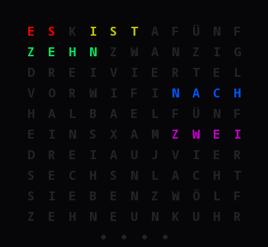
  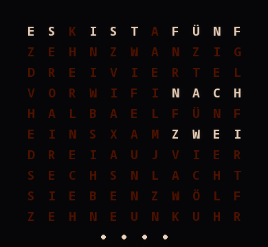
  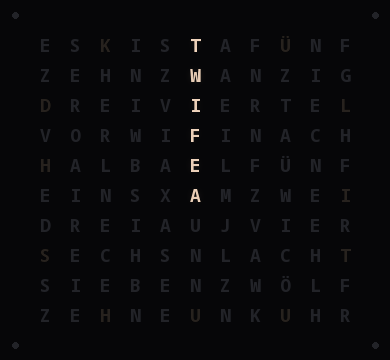
</p>

It is made for the 3D printed word clock by Mirc0 as built in the
[prilchen.de guide](https://prilchen.de/word-clock-mit-esp32-bauen-komplette-anleitung/)
([print files on MakerWorld](https://makerworld.com/de/models/2461080-word-clock-with-esp32-rtc-web-interface)):
a 10 × 11 letter front, 114 WS2812B LEDs and an ESP8266 or ESP32. The original firmware is a
standalone Arduino sketch; this project replaces it with ESPHome so the clock becomes a regular
Home Assistant device.

All images in this README are rendered from the actual firmware code (see [Development](#development)).

## Contents

- [Features](#features)
- [Hardware](#hardware)
- [Installation](#installation)
- [Home Assistant](#home-assistant)
- [Configuration](#configuration)
- [Customizing](#customizing)
- [Development](#development)
- [Limitations](#limitations)
- [Credits and license](#credits-and-license)

## Features

**Clock faces**

- **Word clock** in 5 minute steps, with four dots below the letters for the minutes in between. Two
  dialects: *West* ("viertel nach zwei", "viertel vor drei") and *East* ("viertel drei",
  "dreiviertel drei").
- **Analog clock**: hour and minute hands, twelve faint hour marks and an optional seconds dot
  running around the border.
- **Color sets**: Single color (from the light entity) or Rainbow, Sunset, Ocean, Forest, Fire,
  Pastel and Aurora. Every word (or hand) gets its own hue and all of them drift slowly through
  the set.
- Night mode with its own brightness, smooth cross-fades between minutes, and a current limit
  so that a white all-on frame cannot overload the power supply.

**Timer**

The clock time always stays visible on top of the timer, in its own color.

| Letters | Ring | Pie (on the analog clock) |
|---|---|---|
|  | 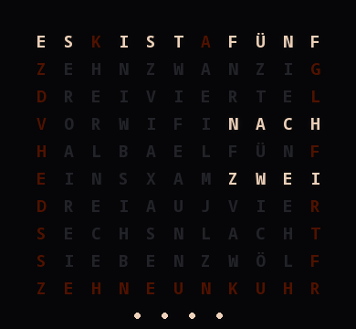 | 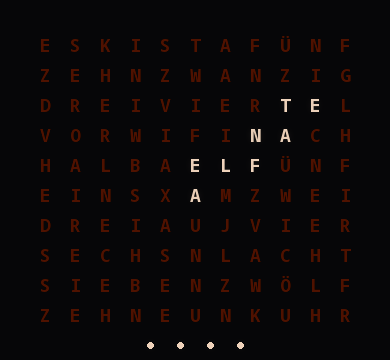 |
| All free letters light up dimmed and disappear from the bottom right. In the last minute exactly 60 letters are lit at full brightness and one goes out per second. | The border winds back to 12 o'clock: once over the whole time, then once more for the last minute. | The same as a pie slice across the whole front. |

At zero the whole front blinks in the timer color until the timer is stopped or the ring
duration (default 120 s) has passed. The images above are time-lapses of a 5 minute timer.

Timers can be started from Home Assistant, from Home Assistant timer helpers, by voice through
Assist, or from Alexa (via the Alexa Media Player integration).

**Notification animations**

| Door | Doorbell | 3D printer | Washer | Mail | Warning |
|---|---|---|---|---|---|
| 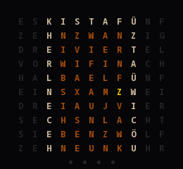 | 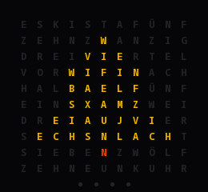 | 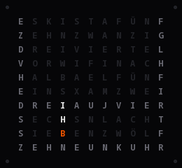 | 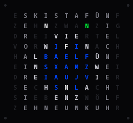 | 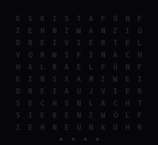 | 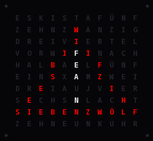 |

There is also *done*, a green check mark. Animations cover the clock face; a running timer keeps
counting behind them.

**Offline operation**

The time comes from Home Assistant and SNTP. An optional DS3231 RTC module keeps it across power
cuts without WiFi; the firmware detects at boot whether one is connected. Without WiFi the
"WIFI" field on the front pulses blue and a fallback hotspot opens for setup.

## Hardware

| Part | Notes |
|---|---|
| ESP8266 (Wemos/LOLIN D1 mini) **or** ESP32 dev board | both are supported, see the board files |
| WS2812B strip, 60 LEDs/m (16.4 mm pitch) | 10 pieces of 11 LEDs + 1 piece of 4 LEDs = 114 LEDs |
| 5 V power supply, ≥ 3 A | e.g. a USB-A charger with a USB-A to USB-C cable (USB-C PD chargers need CC resistors on the socket) |
| DS3231 RTC module, optional | must be a **DS3231**, not a DS1307 (5 V only) |
| 330 Ω resistor, 1000 µF / ≥ 6.3 V capacitor | recommended, see below |
| 3D printed front, LED holder and back cover | from the MakerWorld model above |

### LED layout

The strips are laid as a serpentine: row 0 runs left to right, row 1 right to left and so on,
starting at the top left letter. The four minute dots sit in a row centered below the letters and
follow as LEDs 110 to 113 from left to right; they fill up from the left for 1 to 4 minutes past
each 5 minute step. Follow the arrows on the strip when soldering.

```
      col  0 1 2 3 4 5 6 7 8 9 10
   row 0   E S K I S T A F Ü N F      → LEDs   0..10
       1   Z E H N Z W A N Z I G      ← LEDs  11..21
       2   D R E I V I E R T E L      → LEDs  22..32
       3   V O R W I F I N A C H      ← LEDs  33..43   (W I F I = WiFi status field)
       4   H A L B A E L F Ü N F      → ...
       5   E I N S X A M Z W E I
       6   D R E I A U J V I E R
       7   S E C H S N L A C H T
       8   S I E B E N Z W Ö L F
       9   Z E H N E U N K U H R      ← LEDs  99..109
                ● ● ● ●                → LEDs 110..113 (minute dots)
```

Filler letters such as the K in "ES K IST" are never lit by the time, only by timers and
animations.

### Wiring

| Signal | ESP8266 D1 mini | ESP32 |
|---|---|---|
| LED data (DIN) | **RX** (GPIO3) | GPIO5 |
| DS3231 SDA (optional) | D2 (GPIO4) | GPIO21 |
| DS3231 SCL (optional) | D1 (GPIO5) | GPIO22 |
| DS3231 VCC / GND | 3V3 / G | 3V3 / GND |

On the ESP8266 the LED data line **must** be on RX: only that pin is driven by DMA, which keeps
the LED timing intact while WiFi is busy. Disconnect it while flashing over USB.

Power:

- Feed the LED strip **directly** from the power supply, not through the board's 5 V pin. Supply
  the board from the same point in parallel (5V/VIN pin). Otherwise the full LED current flows
  through the small protection diode on the board.
- Connect all grounds. Never connect the data line without ground.
- Put a 330 Ω resistor in the data line close to the first LED and a 1000 µF capacitor across
  5 V and GND at the start of the strip.
- The boards output 3.3 V logic. Most WS2812B strips accept that; if yours flickers or shows wrong
  colors, add a level shifter (e.g. 74AHCT125).
- Rough current draw at 80 % brightness in the default colors: about 0.4 to 0.7 A for the time
  alone, up to about 1.5 A while everything blinks.
- Some DS3231 modules (e.g. ZS-042) charge the coin cell. With a non-rechargeable CR2032, remove
  the charging diode.

## Installation

The firmware is an ESPHome configuration split into a reusable package and a small device file
that you adapt.

1. Download the repository (`git clone https://github.com/martpp/esphome-wordclock.git` or *Code → Download ZIP*)
   and copy the contents of the [`esphome/`](esphome) folder into your ESPHome configuration
   directory (the one with your other device YAML files), so that `wordclock/` sits next to
   your device file:

   ```
   config/
   ├── wordclock-esp8266.yaml   (or wordclock-esp32.yaml)
   ├── secrets.yaml
   └── wordclock/
       ├── core.yaml
       ├── esp8266.yaml
       ├── esp32.yaml
       └── wordclock.h
   ```

2. Add the entries from [`secrets.yaml.example`](esphome/secrets.yaml.example) to your
   `secrets.yaml` (WiFi, API key, hotspot password).
3. Adjust `name`, `friendly_name` and `timezone` in the device file.
4. Flash once over USB (ESPHome dashboard → Install → Plug into this computer, or
   `esphome run wordclock-esp8266.yaml`). Later updates go over the air.
5. Home Assistant discovers the clock; add it under *Settings → Devices & services*.

The device file only contains what is specific to your clock:

```yaml
substitutions:
  name: wordclock
  friendly_name: Word Clock
  timezone: Europe/Berlin

packages:
  wordclock: !include wordclock/esp8266.yaml

api:
  encryption:
    key: !secret wordclock_api_key

wifi:
  ssid: !secret wifi_ssid
  password: !secret wifi_password
  ap:
    password: !secret wordclock_ap_password
```

## Home Assistant

### Entities

Entity IDs below assume `name: wordclock`; they start with your device name.

| Entity | Purpose |
|---|---|
| `light.wordclock` | color and brightness of the time; effects *Word Clock* (default) and *LED Test* |
| `light.wordclock_timer_color` | color and brightness of the timer |
| `select.wordclock_display` | *Word Clock* or *Analog Clock* |
| `select.wordclock_color_set` | *Single Color*, *Rainbow*, *Sunset*, *Ocean*, *Forest*, *Fire*, *Pastel*, *Aurora* |
| `select.wordclock_timer_style` | *Letters*, *Ring*, *Pie* |
| `number.wordclock_timer_minutes`, `button.wordclock_start_timer` | start a timer from a dashboard |
| `button.wordclock_stop_timer` | cancel the timer or stop it from ringing |
| `sensor.wordclock_timer_end` | timestamp when the timer runs out (works with timer cards) |
| `sensor.wordclock_timer_duration` | original timer duration |
| `sensor.wordclock_timer_status` | `idle`, `running` or `ringing` |
| `binary_sensor.wordclock_timer_ringing` | for automations, e.g. to play a sound |
| `select.wordclock_animation`, `button.wordclock_play_animation` | try out the animations |
| `binary_sensor.wordclock_rtc_module` | whether a DS3231 was found at boot (diagnostic) |

Configuration entities: *Dialect*, *Night Mode* with *Night Start*, *Night End* and *Night
Brightness*, *Seconds Hand*, *Color Cycle Duration*, *Ring Duration*, *Timer Prelude Brightness*.

### Actions

ESPHome registers these actions in Home Assistant, prefixed with the device name:

| Action | Data | Effect |
|---|---|---|
| `esphome.wordclock_timer_start` | `seconds` | start a new timer |
| `esphome.wordclock_timer_sync` | `remaining`, `total` (seconds) | show a timer that runs elsewhere; `total` is the original duration |
| `esphome.wordclock_timer_stop` | | cancel or stop ringing |
| `esphome.wordclock_animation_show` | `name`, `seconds` | play `door`, `doorbell`, `printer`, `washer`, `mail`, `done` or `warning`; `seconds: 0` plays one cycle, otherwise it repeats for that long |
| `esphome.wordclock_animation_stop` | | end the animation |

```yaml
action: esphome.wordclock_animation_show
data:
  name: washer
  seconds: 15
```

### Blueprints

[`homeassistant/blueprints/automation/wordclock/`](homeassistant/blueprints/automation/wordclock)
contains ready-made automations. Click an *Import* button below, or copy the folder to
`config/blueprints/automation/` in your Home Assistant configuration.

| Blueprint | What it does | |
|---|---|---|
| [`mirror_timer.yaml`](homeassistant/blueprints/automation/wordclock/mirror_timer.yaml) | shows selected timer helpers (start, restart, pause, cancel) on the clock | [](https://my.home-assistant.io/redirect/blueprint_import/?blueprint_url=https%3A%2F%2Fgithub.com%2Fmartpp%2Fesphome-wordclock%2Fblob%2Fmain%2Fhomeassistant%2Fblueprints%2Fautomation%2Fwordclock%2Fmirror_timer.yaml) |
| [`alexa_timer.yaml`](homeassistant/blueprints/automation/wordclock/alexa_timer.yaml) | shows Alexa timers ("Alexa, set a timer for 10 minutes"); needs [Alexa Media Player](https://github.com/alandtse/alexa_media_player) | [](https://my.home-assistant.io/redirect/blueprint_import/?blueprint_url=https%3A%2F%2Fgithub.com%2Fmartpp%2Fesphome-wordclock%2Fblob%2Fmain%2Fhomeassistant%2Fblueprints%2Fautomation%2Fwordclock%2Falexa_timer.yaml) |
| [`voice_timer.yaml`](homeassistant/blueprints/automation/wordclock/voice_timer.yaml) | Assist sentences to start and stop the timer (English and German defaults) | [](https://my.home-assistant.io/redirect/blueprint_import/?blueprint_url=https%3A%2F%2Fgithub.com%2Fmartpp%2Fesphome-wordclock%2Fblob%2Fmain%2Fhomeassistant%2Fblueprints%2Fautomation%2Fwordclock%2Fvoice_timer.yaml) |
| [`notification_animation.yaml`](homeassistant/blueprints/automation/wordclock/notification_animation.yaml) | plays an animation when an entity changes, e.g. a doorbell event or a washer status switching to "finished" | [](https://my.home-assistant.io/redirect/blueprint_import/?blueprint_url=https%3A%2F%2Fgithub.com%2Fmartpp%2Fesphome-wordclock%2Fblob%2Fmain%2Fhomeassistant%2Fblueprints%2Fautomation%2Fwordclock%2Fnotification_animation.yaml) |

Each blueprint asks for the ESPHome device name, so they work with any `name:`.

## Configuration

Substitutions you can set in the device file:

| Substitution | Default | Meaning |
|---|---|---|
| `name` | `wordclock` | ESPHome node name; also the prefix of entities and actions |
| `friendly_name` | `Word Clock` | display name; the hotspot is called "&lt;friendly_name&gt; Setup" |
| `timezone` | `Europe/Berlin` | time zone for HA time, SNTP and the RTC |
| `max_current_ma` | `3500` | upper limit of the estimated LED current |
| `fade_ms` | `400` | cross-fade duration |
| `led_pin` | `GPIO3` (ESP8266), `GPIO5` (ESP32) | LED data pin |
| `sda_pin`, `scl_pin` | `GPIO4`/`GPIO5` (ESP8266), `GPIO21`/`GPIO22` (ESP32) | I²C pins for the RTC |

Anything else can be overridden with the usual ESPHome package mechanisms, for example:

```yaml
web_server: !remove        # no web interface on the clock
```

## Customizing

All rendering lives in [`esphome/wordclock/wordclock.h`](esphome/wordclock/wordclock.h), plain
C++17 without ESPHome dependencies.

- **Another front layout**: the word positions are `constexpr Word NAME{row, col, length}`
  near the top, `time_mask()` picks the words for a time. The layout comment and the tests show
  how row/column map to LEDs.
- **A new color set**: add an entry to `PALETTES` (up to six colors) and an option at the same
  position in the *Color Set* select in `core.yaml`.
- **A new animation**: extend `enum class Animation`, `ANIMATION_NAMES` and
  `ANIMATION_CYCLE_MS`, write a `draw_...()` function using `put()`, `hline()` and `vline()`,
  add it to `render_animation()` and add the option to the *Animation* select in `core.yaml`.
  Animations are drawn in code instead of bitmaps because constant data ends up in the
  ESP8266's scarce RAM.

## Development

```sh
./test/run_tests.sh            # host tests (uses g++ or a gcc container via podman/docker)
./test/run_tests.sh demo       # timer preview in the terminal
```

The tests check the LED layout against the original sketch, every minute of the day in both
dialects, the timer phases including the `millis()` wrap-around, color sets, clock hands, the
circular countdown and the animations.

The images in this README are rendered from the same code:

```sh
mkdir -p build
./test/run_tests.sh export > build/scenes.json
python3 tools/make_gifs.py build/scenes.json docs/images        # needs Pillow
python3 tools/make_preview.py build/scenes.json build/preview.html   # interactive page
```

To build the firmware locally, copy `esphome/secrets.yaml.example` to `esphome/secrets.yaml`,
fill in an API key and run `esphome compile esphome/wordclock-esp8266.yaml`. GitHub Actions
runs the tests and builds both example configurations with ESPHome 2026.10.0; the firmware images
are attached to each run as artifacts.

## Limitations

- The letter layout is the German front of the Mirc0 design. Other languages need a different
  `time_mask()`.
- The RTC module is only detected at boot; restart the clock after connecting one.
- With `web_server` enabled, its `/update` page accepts firmware without the OTA encryption key.
  Remove `web_server` or protect it with `auth:` if your network is not trusted.
- WS2812B LEDs have 256 levels per channel. After gamma correction only a few remain at low
  brightness, so fades at night look slightly stepped. This is a limit of the LEDs, not of the
  microcontroller.

## Credits and license

- Front design and original "Wortuhr V3" firmware by Mirc0; build guide by
  [prilchen.de](https://prilchen.de/word-clock-mit-esp32-bauen-komplette-anleitung/). The LED
  layout in this project is derived from the word indices of that sketch.
- This firmware is released under the [MIT License](LICENSE). See the [changelog](CHANGELOG.md)
  for releases.
